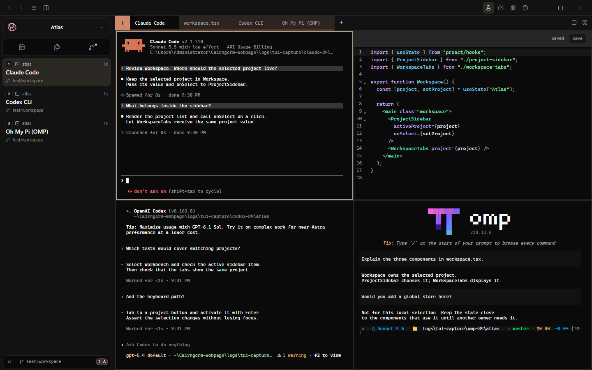

  <picture>
    <source media="(prefers-color-scheme: dark)" srcset="docs/media/gem-dark.svg">
    
  </picture>

<h1 align="center">Cairngorm</h1>

  Your coding agents, terminals, files and Git — together in one desktop workspace.

  
  

Claude Code, Codex CLI and Oh My Pi in a split view with the editor, from <a href="https://cairngorm.dev">cairngorm.dev</a>.

## What only Cairngorm does

### Your agents work in your desktop apps

Ask Claude Code, Codex or any connected agent to build a chart in Excel or edit a Word
document. The agent drives the installed application through its own automation API, and
on Windows the application window docks in a pane right beside the terminal. Cairngorm
asks before an agent first uses each application, and you choose how far that approval
reaches. See [Security](docs/security.md).

### Spreadsheets your agent edits while you watch

Spreadsheets open in a pane next to the agent. The agent reads and changes the open
workbook through typed operations, and Cairngorm saves every change with a version check
and a backup. [Document providers](docs/document-providers.md) add new file types without
rebuilding Cairngorm.

### Whiteboards and diagrams for your agent CLIs

tldraw, Excalidraw, draw.io and Mermaid canvases open beside the terminal as interactive
panes. One plugin catalog serves Claude Code, Codex, Gemini CLI, OpenCode, Pi and other
agent CLIs over MCP, and you can connect your own MCP client.

### Watch your browser tests run

Follow live Playwright pages in Chromium, Firefox and WebKit, pause on any frame, and keep
the last screenshot after the browser closes. A separate [test browser](docs/test-browser.md)
lets you click through your app without touching the run.

### Agents that keep working

Schedule a prompt on the calendar and Cairngorm runs it with Codex, Gemini CLI or its own
agent, then lists the files it changed in Git projects. Close the window while an agent
is working and it keeps running in the background; reopen Cairngorm and agent sessions
come back.

### Your quota at a glance

See the 5-hour and weekly limits of your Codex and Claude Code subscriptions in one panel,
read without spending a single request. Claude Code limits appear after it answers its
first message.

## Keep the work together

**Bring your agents.** Run Pi, Claude Code, Codex, Gemini CLI, OpenCode or another
installed CLI. Your tools keep their own configuration and sign-ins; no Cairngorm account
required. An optional built-in agent connects to your own model provider.

**Make room for your workflow.** Split terminals, detach windows and keep each
project's files, documents and Git changes close by.

**Open it from any terminal.** `cairngorm .` opens the folder as a project and
`cairngorm -a claude` starts Claude Code in it. See [the `cairngorm` command](docs/command-line.md).

---

**Development build.** Features vary by OS; application docking and scheduled agent
execution currently require Windows. On macOS agents drive scriptable applications in
their own windows; on Linux, applications that ship an MCP server. Provider usage is
billed separately.

[Settings](docs/settings-file.md) · [Security](docs/security.md) ·
[Contributing](docs/development.md#contributing) · [Reporting a vulnerability](SECURITY.md)

Cairngorm is released under the [MIT License](LICENSE). Third-party components keep their
own licenses; see [licenses/](licenses/).
